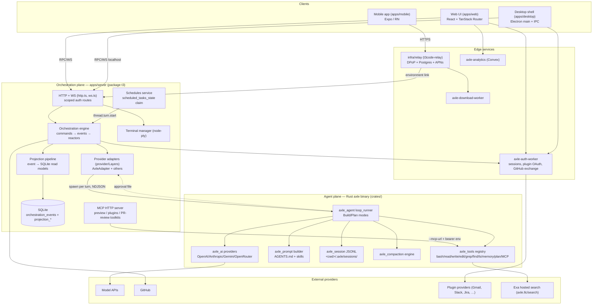
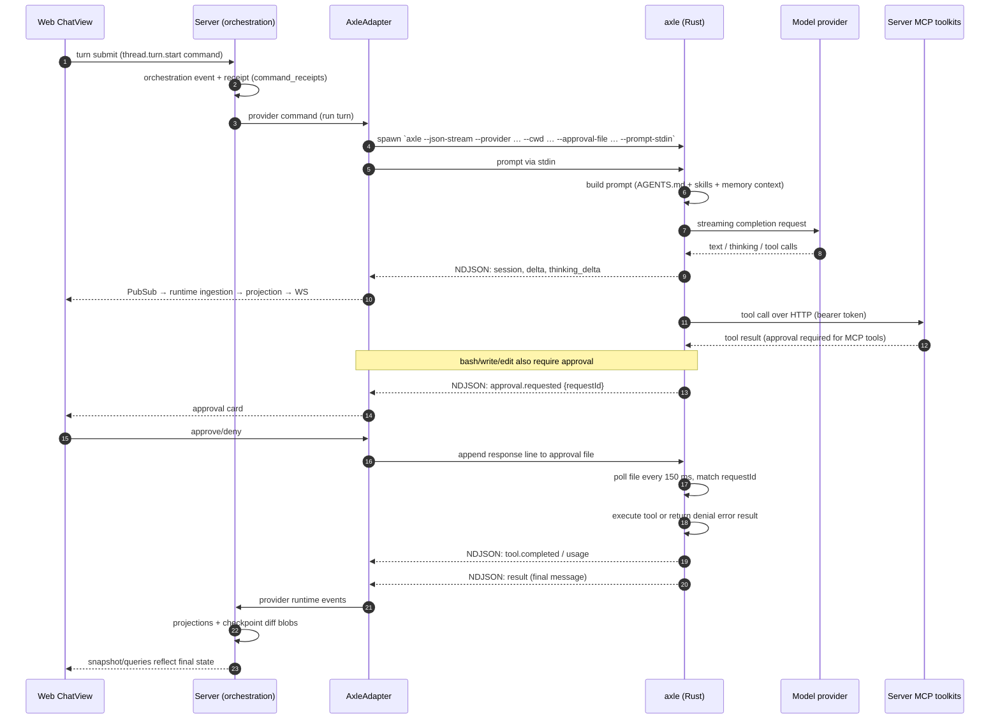
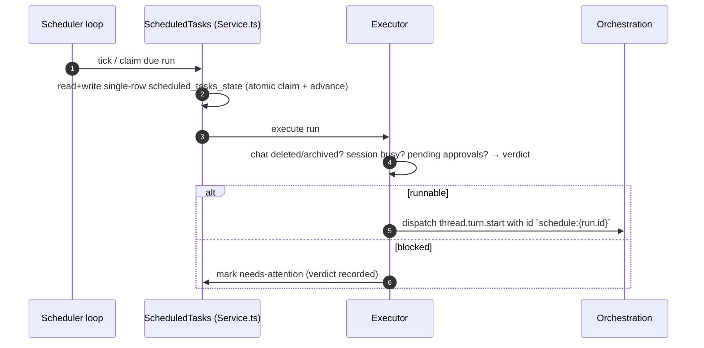
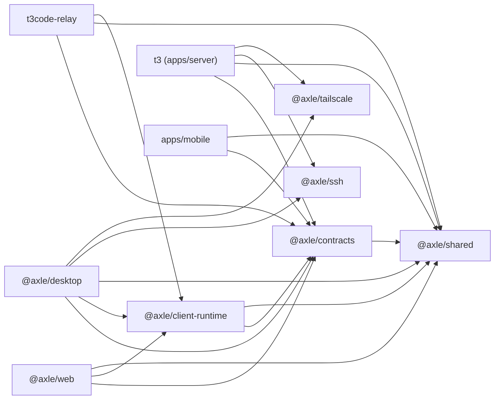

# 02 — System Architecture

Part of the Axle codebase-intelligence dossier (index: `CODEBASE_INTELLIGENCE_INDEX.md`). Evidence date 2026-10-13. Labels: **[V]** verified, **[I]** inference, **[U]** unknown.

---

## 1. Architectural style

Axle is a **local-first, two-plane system with an event-sourced orchestration core**:

1. **Agent plane (Rust).** A self-contained agent runtime (`axle` binary) that owns prompt assembly, model streaming, tool execution, approvals, sessions, compaction, and memory. It is deliberately process-isolated from everything else. **[V]**
2. **Orchestration plane (TypeScript).** An Effect-based server that owns the user-facing domain (projects, threads, turns, messages, activities, approvals, proposed plans), persists them event-first, and projects them into SQLite read models for the UI. **[V]**
3. **Clients** (web, desktop, mobile) talk to the orchestration plane only; the orchestration plane talks to the agent plane only over the NDJSON stdio protocol. **[V]**
4. **Edge services** (auth worker, relay, download worker) are independent Cloudflare deployments; the relay is the only path by which a mobile device reaches a user's environment, and it is bearer/DPoP-authenticated. **[V]**

## 2. Container diagram

## 3. Chat-turn runtime flow (the critical path)

**[V]** for: spawn args (`AxleAdapter.ts:949-1013`), NDJSON event names (decoder 246-508), approval file write (`AxleAdapter.ts:861-869`) and poll (`loop_runner.rs:102-145`), MCP auth env `T3_MCP_BEARER_TOKEN` (`AxleAdapter.ts:53-55`), MCP tool approval (`axle_tools/src/mcp.rs:592-596`), orchestration events/receipts (migrations `001`/`002`), projections (migration `005`).

## 4. Scheduled-task flow

**[V]** for the SQLite claim pattern (`schedules/Service.ts:42-43,162-172`) and the service tag `axle/schedules/ScheduledTasks` (`Service.ts:22`); the "verdict/needs-attention" logic is in the same file (inspect `100-120` region for exact rules) — **[I]** for precise reasons list (see `03-feature-catalog.md` and `14-open-questions-and-unknowns.md`).

## 5. Package dependency graph (TypeScript workspace)

**[V]** from each package.json dependency lists (`packages/*/package.json`, `apps/*/package.json`, `infra/relay/package.json`). Note `apps/server` also lists `@axle/web` as a devDependency (server builds/serves the web bundle). Test-only edges omitted.

## 6. Patterns consistently applied

- **Single-writer orchestration with command receipts.** Every state change starts as a command with a deterministic id and is recorded in `command_receipts` for idempotency (migration `002`). **[V]**
- **Event-sourcing + projection separation.** Immutable `orchestration_events`; `projection_*` tables are rebuildable read models (migration `005`: projects, threads, thread_messages, thread_activities, thread_sessions, turns, pending_approvals, state). **[V]**
- **Effect services/layers everywhere in TS.** `Context.Service` tags (e.g. `axle/schedules/ScheduledTasks`) with `*Live` layers; schemas come from `@axle/contracts`. **[V]**
- **Tagged errors, not exceptions**, in server/contract layers (`Schema.TaggedErrorClass` throughout `packages/contracts`). **[V]**
- **Process isolation of the agent runtime.** One `axle` process per turn; crash/failure is surfaced as a retryable adapter error class rather than corrupting server state (`AxleAdapter.ts:146-179`). **[V]**
- **Append-only session files with repair-on-load.** JSONL with a validated header; `repair_tool_protocol` (manager.rs:371-426) drops orphan tool results and injects interrupted markers. **[V]**
- **File-based approval channel** kept intentionally simple (line-delimited JSON, stale-line tolerant, 150 ms polling). **[V]**
- **Path guard before any file tool**: traversal rejection, write-ancestor walk, skip-dir list (`path_guard.rs:95-111`). **[V]**
- **Secret hygiene in memory store**: pattern rejection for API keys/tokens/PEM (`axle_memory/src/lib.rs:61-84`). **[V]**

## 7. Patterns partially applied or inconsistent

- **Two parallel tool systems.** Rust built-ins (`axle_tools`) vs server-side MCP toolkits (`apps/server/src/mcp/toolkits/*`) — different naming conventions (`snake_case` vs `axle_plugin_call`/`getPullRequestComments`). **[V]**
- **Hidden control tools.** `{"end_task"}` is filtered from client-visible activity in `AxleAdapter.ts:55`; the Rust loop suppresses its lifecycle events (`loop_runner.rs:2186-2231`). Behavior is correct but the "hidden" convention is implicit. **[V]**
- **Plan-mode capabilities** exist both as a Rust tool restriction (`PLAN_TOOL_NAMES`, `registry.rs:55-65`) and as a TS interaction mode (`--interaction-mode plan|build`); the two must be kept in sync manually. **[V]**
- **Toolkit source directory naming**: toolkits live under `apps/server/src/mcp/toolkits/` (not `orchestration/toolkits`), while registrations in `McpHttpServer.ts:214-291` reference Preview/Plugin/PullRequestReview. **[V]**
- **`schedules/Service.ts` violates the repo's own lint rule** (`t3code(namespace-node-imports)`), i.e. the path of least resistance for SQLite access in that service breaks the codebase convention. **[F]**
- **Version drift across publish surfaces** (Rust/TS 1.1.22 vs download worker ~1.1.15 vs analytics 0.0.29 vs README v1.1.23) suggests release automation that does not cover all surfaces. **[V]** for numbers, **[I]** for cause.

## 8. Critical decisions and trade-offs

| Decision | Evidence | Trade-off |
| --- | --- | --- |
| Agent runtime in Rust, server in TS | `crates/*`, `apps/server` | Strong isolation + performance; two toolchains, duplicated effort (e.g. prompt/skills logic only in Rust) |
| NDJSON over stdio instead of library embedding | `AxleAdapter.ts:246-508` | Language-agnostic, crash-isolated, replayable; every feature crosses a serialization boundary, protocol drift risk |
| File-based approval protocol | `loop_runner.rs:42-145` | Works with any UI, survives restarts; polling latency (150 ms), stale-line tolerance needed |
| Event-sourced orchestration + SQLite projections | migrations `001-005` | Rebuildable read models, audit trail; more moving parts and migration volume (32 migrations) |
| JSONL sessions per cwd | `axle_session/src/manager.rs:128` | Human-inspectable, append-only, repair-friendly; whole-file rewrite on compaction |
| MCP for browser/plugin/PR tools instead of native Rust tools | `apps/server/src/mcp/`, `AxleAdapter` flags | Server owns privileged capabilities; agent must run with MCP URL + bearer env; MCP tools always require approval |
| Alchemy stubbed locally | `pnpm-workspace.yaml` override `alchemy: file:stubs/alchemy-stub` | Local builds/tests work without network; local behavior diverges from real deploy |

## 9. Boundary inventory (what crosses what)

1. **Client → server**: contracts in `@axle/contracts` (Effect Schema); WS + HTTP; scoped auth (`AuthOrchestrationReadScope` / `AuthOrchestrationOperateScope`, `http.ts:200-246`). **[V]**
2. **Server → agent**: argv flags + stdin prompt + NDJSON stdout + approval file + env (`T3_MCP_BEARER_TOKEN`). **[V]**
3. **Agent → server**: HTTP MCP calls (bearer), tool results. **[V]**
4. **Server → cloud**: auth worker (session/MCP/plugin endpoints), GitHub API, Expo/APNs via relay. **[V]** for endpoints listed in `axle-auth-worker/src` and relay routes.
5. **Mobile → relay → environment**: relay `RelayApi` + DPoP; relay stores device registrations and APNs deliveries in Postgres. **[V]**
